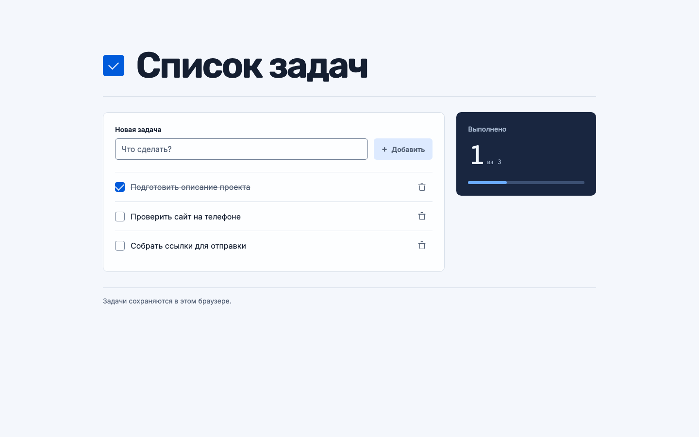

# Список задач

Одностраничное приложение для личных задач. Можно добавлять задачи, отмечать их выполненными, возвращать в работу и удалять. Счётчик показывает прогресс, а список сохраняется в этом браузере после обновления страницы.



## Запуск

Понадобятся Node.js 20.9 или новее и npm.

```bash
npm ci
npm run dev
```

Откройте [http://localhost:3000](http://localhost:3000).

## Как устроен проект

- `app/page.tsx` задаёт разметку страницы.
- `app/task-list.tsx` содержит интерфейс списка и обработчики действий.
- `app/task-storage.ts` читает и проверяет сохранённые данные, а также записывает изменения в `localStorage`. Если запись не удалась, приложение показывает ошибку и сохраняет предыдущий список и введённый текст.
- `tokens.css` задаёт палитру и типографику. Адаптивная раскладка и состояния элементов находятся в `app/globals.css`.

Приложение написано на Next.js, React и TypeScript. Данные хранятся в браузере и не синхронизируются между устройствами. Команда `npm run build` создаёт статический сайт в каталоге `out/`, готовый к размещению на статическом хостинге.

## Проверка

```bash
npx playwright install chromium
npm test
npm run typecheck
npm run build
```

Playwright проверяет добавление, переключение статуса и удаление после перезагрузки, отклонение пустого ввода и независимость задач с одинаковыми названиями. Если локальный сервер уже запущен, передайте его адрес командой `PLAYWRIGHT_TEST_URL=http://localhost:3000 npm test`.

## Использование AI

Codex помог спланировать и реализовать приложение, провести ревью кода и проверить сценарии в Chromium. Для оформления использован Hallmark, а Ponytail помог сохранить небольшую структуру проекта и ограничиться необходимыми зависимостями.
